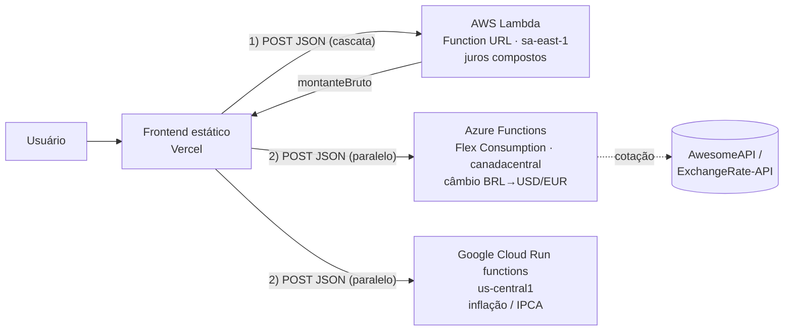

# SaaS Financeiro Multicloud — Grupo A

Atividade Prática 04 de **Computação em Nuvem I** (Fatec Itapira — DSM, Prof. Me. Reginaldo Donizeti Cândido).

O usuário informa um plano de investimento e recebe três respostas, cada uma calculada por uma função serverless em uma nuvem diferente:

| # | Função | Nuvem | O que faz |
|---|---|---|---|
| 1 | Calculadora de Juros Compostos | **AWS Lambda** | aporte inicial e mensal, taxa e meses → montante bruto, rendimentos e série mês a mês |
| 2 | Conversor de Câmbio Internacional | **Azure Functions** | montante em BRL → USD e EUR, com cotação de API pública e tabela fixa de reserva |
| 3 | Projetor de Inflação e Poder de Compra | **Google Cloud Run functions** | aplica o IPCA ao montante → valor real, ganho real e perda de poder de compra |

## Integrantes

| Nome | GitHub |
|---|---|
| João Lucas Altafini | [@JLBatista](https://github.com/JLBatista) |
| Julia Nicioli | [@julianicioli](https://github.com/julianicioli) |
| João Gabriel Moimaz | [@GabrielMS17](https://github.com/GabrielMS17) |
| Luan Trani | — |

## Links ativos

| O quê | URL |
|---|---|
| **Frontend (Vercel)** | https://saas-financeiro-grupo-a.vercel.app |
| AWS Lambda — juros compostos | `POST` https://hfzju3c5szs6sminjuri4tpgwi0mzgnh.lambda-url.sa-east-1.on.aws/ |
| Azure Functions — câmbio | `POST` https://cambio-grupoa-fatec-aae6fbfdcnhrcnay.canadacentral-01.azurewebsites.net/api/cambio |
| Google Cloud — inflação | `POST` https://inflacao-20304353773.us-central1.run.app |

## Arquitetura



- **Só PaaS/FaaS:** nenhuma VM ou contêiner gerenciado pelo grupo.
- **Cascata + paralelo:** a AWS é chamada primeiro; com o montante dela, Azure e GCP rodam juntas (`Promise.allSettled`).
- **Resiliência:** cada chamada tem **timeout de 4 s** (`AbortController`). Se uma nuvem falhar, demorar ou responder erro, só aquele card mostra **"Serviço Temporariamente Indisponível"** e usa o **cálculo local de fallback**; os outros seguem normais. O botão **Tentar de novo** refaz só a chamada que falhou.
- **Rastreio:** um `X-Request-Id` comum às três chamadas aparece na resposta e nos logs de cada nuvem.
- **Segurança:** o frontend só conhece as três URLs públicas. Nenhuma chave ou credencial está no código ou no GitHub (as APIs de câmbio são públicas e chamadas de dentro da função Azure). O CORS das três nuvens libera só o domínio da Vercel (e `localhost:5173` para desenvolvimento).

## Especificação dos endpoints

Todas as funções recebem e respondem **JSON**, aceitam `POST` (e `OPTIONS` de CORS) e respondem **200** (sucesso), **400** (parâmetros inválidos) ou **500** (falha interna). Com `?simularErro=true` qualquer uma devolve **500** — é o que os interruptores *Simular falha* do frontend usam na demonstração de resiliência.

Formato de erro comum:

```json
{ "status": "error", "erro": "VALIDACAO", "detalhes": [ { "campo": "tempoMeses", "mensagem": "deve ser um inteiro entre 1 e 600" } ], "requestId": "a1b2c3" }
```

```json
{ "status": "error", "erro": "INTERNO", "mensagem": "Falha simulada (simularErro=true)", "requestId": "a1b2c3" }
```

### 1. AWS Lambda — Juros Compostos

`M = P(1+i)^n + A·[(1+i)^n − 1]/i` (aporte mensal no fim de cada mês). Com `tipoTaxa: "anual"`, a taxa mensal equivalente é `(1 + a)^(1/12) − 1`.

Request:
```json
{ "aporteInicial": 1000, "aporteMensal": 200, "taxaJuros": 12, "tipoTaxa": "anual", "tempoMeses": 24 }
```
Response 200:
```json
{
  "status": "success",
  "provider": "AWS Lambda (sa-east-1)",
  "data": {
    "montanteBruto": 6616.52,
    "totalInvestido": 5800,
    "totalRendimentos": 816.52,
    "taxaMensal": 0.9489,
    "historicoEvolucao": [1000, 1209.49, 1420.97, "...", 6616.52]
  },
  "requestId": "a1b2c3"
}
```
Validação (400): aportes negativos (ou os dois zerados), `taxaJuros` fora de 0–100, `tempoMeses` fora de 1–600, `tipoTaxa` diferente de `mensal`/`anual`.

### 2. Azure Functions — Câmbio Internacional

Com `modo: "api"` (padrão) busca a cotação na **AwesomeAPI**; se ela falhar, tenta a **ExchangeRate-API**; se as duas falharem, ou com `modo: "fixa"`, usa a tabela fixa (USD 5,60 · EUR 6,10). O campo `fonte` diz qual foi usada.

Request:
```json
{ "montanteBRL": 6616.52, "moedas": ["USD", "EUR"], "modo": "api" }
```
Response 200:
```json
{
  "status": "success",
  "provider": "Azure Functions (canadacentral)",
  "data": {
    "valorBRL": 6616.52,
    "valorUSD": 1168.09,
    "valorEUR": 1058.64,
    "cotacaoUSD": 5.6644,
    "cotacaoEUR": 6.25,
    "conversoes": { "USD": { "cotacao": 5.6644, "valor": 1168.09 }, "EUR": { "cotacao": 6.25, "valor": 1058.64 } },
    "fonte": "exchangerate-api"
  },
  "requestId": "a1b2c3"
}
```
Validação (400): `montanteBRL` ausente ou ≤ 0, moeda fora de USD/EUR, `modo` diferente de `api`/`fixa`, JSON inválido.

### 3. Google Cloud Run functions — Inflação e Poder de Compra

`M_real = M / (1 + π)^(n/12)` · `ganho real = M_real − total investido` · `perda = M − M_real`.

Request:
```json
{ "montanteBruto": 6616.52, "totalInvestido": 5800, "taxaInflacao": 4.5, "tempoMeses": 24 }
```
Response 200:
```json
{
  "status": "success",
  "provider": "Google Cloud Functions (us-central1)",
  "data": { "montanteReal": 6058.95, "perdaPoderCompra": 557.57, "ganhoRealLiquido": 258.95, "taxaInflacaoAcumulada": 9.2 },
  "requestId": "a1b2c3"
}
```
Validação (400): `montanteBruto` ausente ou ≤ 0, `totalInvestido` < 0, `taxaInflacao` fora de −10–100, `tempoMeses` ausente ou fora de 1–600.

## Como testar

### Pelo site
1. Abra https://saas-financeiro-grupo-a.vercel.app — ele já abre no modo **APIs Reais** e executa uma simulação.
2. Os três cards devem mostrar **200 OK** com o selo de cada nuvem e a latência em ms.
3. **Resiliência:** marque *Simular falha* de uma nuvem e clique em **Executar**. Só aquele card cai para **Fallback local · HTTP 500**; os outros continuam 200. Desmarque e use **Tentar de novo**.
4. **Métricas:** o painel *Métricas de Latência* registra cada chamada (cold/warm) e o botão **Exportar CSV** gera a planilha para o relatório. Para medir cold start real, deixe as funções ~15 min sem chamadas antes.

### Pela linha de comando
```bash
# AWS — juros compostos (esperado: montanteBruto 6616.52)
curl -X POST https://hfzju3c5szs6sminjuri4tpgwi0mzgnh.lambda-url.sa-east-1.on.aws/ \
  -H "Content-Type: application/json" \
  -d '{"aporteInicial":1000,"aporteMensal":200,"taxaJuros":12,"tipoTaxa":"anual","tempoMeses":24}'

# Azure — câmbio
curl -X POST https://cambio-grupoa-fatec-aae6fbfdcnhrcnay.canadacentral-01.azurewebsites.net/api/cambio \
  -H "Content-Type: application/json" -d '{"montanteBRL":6616.52}'

# GCP — inflação (esperado: montanteReal 6058.95)
curl -X POST https://inflacao-20304353773.us-central1.run.app \
  -H "Content-Type: application/json" \
  -d '{"montanteBruto":6616.52,"totalInvestido":5800,"taxaInflacao":4.5,"tempoMeses":24}'

# Erro 400 e erro 500 simulado (vale para as três)
curl -X POST https://inflacao-20304353773.us-central1.run.app -H "Content-Type: application/json" -d '{}'
curl -X POST "https://inflacao-20304353773.us-central1.run.app?simularErro=true" -H "Content-Type: application/json" -d '{"montanteBruto":100,"tempoMeses":12}'
```

### Localmente
```bash
# Frontend (qualquer servidor estático)
cd frontend-app && npx http-server -p 5173

# Função GCP
cd google-functions && npm install && npx functions-framework --target=projetorInflacao --port=8080
```
O frontend local em `http://localhost:5173` chama as funções reais na nuvem (o CORS libera essa origem).

## Estrutura do repositório

```
aws-lambda/          index.mjs (handler da Lambda) e package.json
azure-functions/     host.json, package.json e src/ (modelo v4: src/functions/cambio.js + src/cambio.js)
google-functions/    index.js (Functions Framework) e package.json
frontend-app/        index.html — frontend único (HTML, Tailwind, Chart.js, fetch)
```

## Como foi feito o deploy

| Nuvem | Serviço | Configuração |
|---|---|---|
| AWS | Lambda + **Function URL** | Node.js 22, `sa-east-1`, 256 MB, timeout 10 s; auth `NONE`; permissões públicas `lambda:InvokeFunctionUrl` e `lambda:InvokeFunction` (via Function URL); CORS na própria Function URL |
| Azure | Functions — plano **Consumo Flexível** | Node.js 22, `canadacentral`, 512 MB; HTTP Trigger `authLevel: anonymous`; CORS no Function App. Deploy por zip com `az functionapp deployment source config-zip` (Cloud Shell) |
| GCP | **Cloud Run functions** | Node.js 22, `us-central1`, máximo 2 instâncias; acesso público (invocação não autenticada); editor in-line do console |
| Frontend | **Vercel** | pasta `frontend-app`, preset *Other*, sem build; publicado com `npx vercel deploy --prod` |

Observações da assinatura **Azure for Students**: ela só permite algumas regiões (Brazil South foi recusada) e não tem cota para o plano de Consumo clássico (Y1), por isso o plano Flex em Canada Central.

## FinOps — depois da avaliação

Os endpoints são públicos. Depois da apresentação, desativar ou excluir:
- **AWS:** função `juros-compostos` e role `juros-compostos-role`;
- **Azure:** grupo de recursos `rg-saas-financeiro` (Function App, plano, storage e Application Insights);
- **GCP:** serviço Cloud Run `inflacao` no projeto `saas-financeiro-grupo-a`;
- **Vercel:** projeto `saas-financeiro-grupo-a`.
